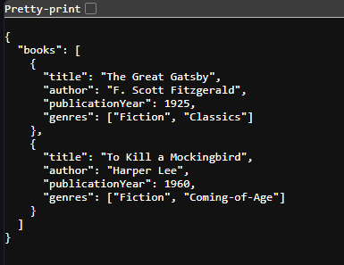
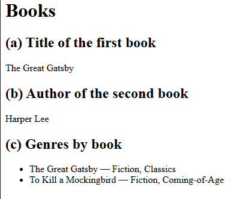
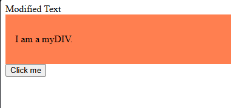
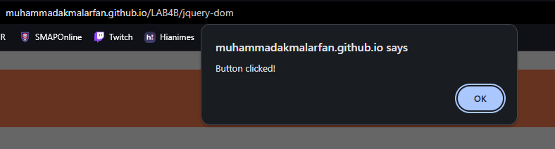

# BIC21203 Lab 4b - JSON and jQuery

**Name:** MUHAMMAD AKMAL ARFAN BIN NIZAM
**Student ID:** CI250141

## Brief Explanation
This lab practises storing data in JSON, loading it with the JavaScript
`fetch()` API, and rewriting native DOM operations using jQuery.

| File | Purpose |
|------|---------|
| `books.json` | JSON data with 2 books (title, author, publicationYear, genres) |
| `books.html` | Loads `books.json` with `fetch()` and displays the data |
| `jquery-dom.html` | jQuery versions of three native DOM operations |

## Live Pages
- Books: https://muhammadakmalarfan.github.io/LAB4B/books.json
- jQuery: https://muhammadakmalarfan.github.io/LAB4B/jquery-dom.html

## How to Run

### books.html
`fetch()` does not work when opening a file directly, so use a local server:
1. Open the folder in VS Code and install the **Live Server** extension.
2. Right-click `books.html` and choose **Open with Live Server**.
3. The page shows the first book's title, the second book's author, and
   the genres of each book.

Or just open the live link above.

### jquery-dom.html
1. Open `jquery-dom.html` in a web browser (an internet connection is
   needed to load jQuery).
2. The text changes to "Modified Text", the div gets a coral background,
   and clicking the button shows an alert "Button clicked!".

## Screenshots

### books.json

### books.html output

### jquery-dom.html output

### Alert after clicking the button

